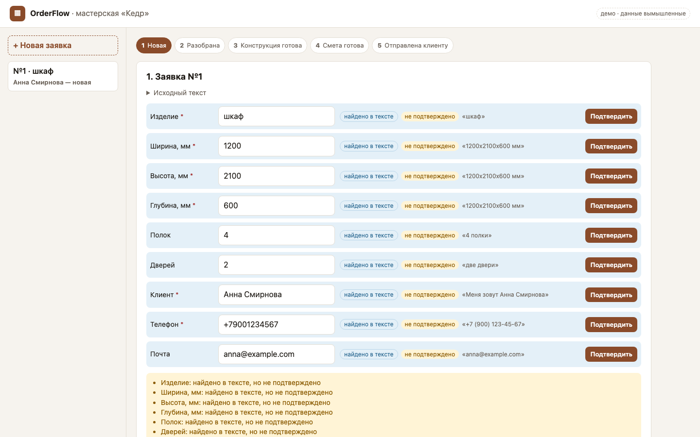
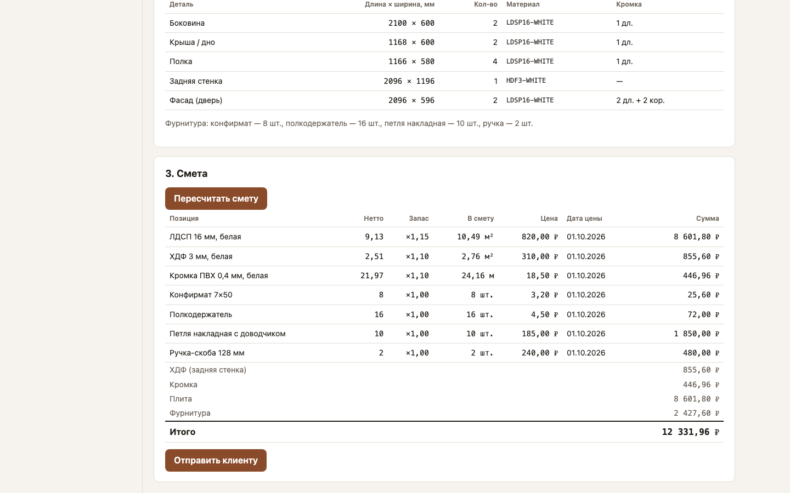
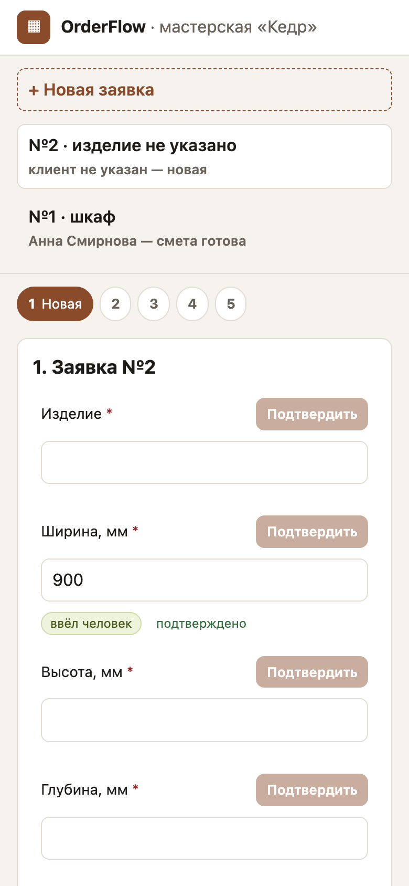

# OrderFlow — заявка → конструкция → смета

В мебельной мастерской заявка приходит текстом: «шкаф 120 на 210, глубина 60, две двери».
Её переписывают в таблицу, детали считают на бумаге, смету — по своей копии прайса.
Ответ уходит через несколько дней. OrderFlow разбирает текст в поля с пометкой
источника, строит из параметров шкафа спецификацию деталей и считает смету по одному
справочнику цен. Мастерская «Кедр», люди и цены вымышлены.



<p>


</p>

## Карта модулей

| Модуль | Что делает | В демо |
|---|---|---|
| Приём заявки | разбор текста, у поля источник, предположение ждёт подтверждения | ✅ |
| Конструкция | параметры шкафа → детали с кромкой, проверка инвариантов | ✅ |
| Смета | плита, кромка, фурнитура, запас; неполный итог, цены разных дат | ✅ |
| Статусы | от «новая» до «отправлена», переход проверяет сервер | ✅ |
| Производство, документы для цеха, раскрой, склад | | ⬜ |
| Обмен с учётной системой | только интерфейс `AccountingExporter` и заглушка | ⬜ |
| Кабинет клиента | | ⬜ |

## Решения и компромиссы

- **Разбор правилами, модель за интерфейсом.** Правила работают без сети. Модель
  подключается через тот же `RequestParser`, и её ответ тоже приходит неподтверждённым ([ADR-0002](docs/03-design/adr/0002-external-services-behind-adapters.md)).
- **Человек подтверждает каждое найденное поле.** Лишний клик, зато ошибка разбора не
  доходит до сметы.
- **Деньги в целых копейках, количества в `Decimal`.** Первая версия во float теряла
  копейку. Плата за это: итоги считает только сервер ([ADR-0003](docs/03-design/adr/0003-money-in-kopecks.md)).
- **Статус меняется как следствие действия.** `PATCH status` отверг: таблица переходов
  на сервере, пропуск шага — 409 ([ADR-0004](docs/03-design/adr/0004-server-side-state-machine.md)).
- **Блокировка строки заявки** (`SELECT … FOR UPDATE`) появилась после ревью. Очередь не
  завёл: смета считается за миллисекунды.

## Что не сделано и почему

- Адаптер языковой модели — заглушка с TODO: сначала замер доли найденных полей на реальных заявках.
- Нет входа и ролей, один интерфейс на всех. Для нескольких сотрудников это первый шаг.
- Экрана справочника цен нет, цены в начальных данных. Отправка сметы пишет в журнал.
- Модель конструкции одна — шкаф. Типы ответов API на фронте описаны руками, клиент по
  `openapi.yaml` не генерируется.
- `make up` не запускал: на машине сборки нет Docker. Остальное проверено на локальном PostgreSQL 16.

## Запуск

```bash
make up                  # Docker: postgres :55301, backend :8301, frontend :5301

make install             # без Docker, нужен PostgreSQL 16
export DATABASE_URL=postgresql+psycopg://postgres@localhost:55301/orderflow
make dev                 # миграции, справочник, API и интерфейс

make lint test e2e       # ruff, mypy strict, eslint, tsc; pytest и Vitest; Playwright
```

Интерфейс — http://localhost:5301, API — http://localhost:8301/docs.
`make test` ждёт базу `orderflow_test` (`TEST_DATABASE_URL`).

## Как это сделано

Код и тесты писал Claude Code по моим брифам, аналитику и приёмку делал я. Ревьюил Codex: 10 находок (4 P1, 6 P2), воспроизвелись все, на каждую сначала падающий
тест. Мои тесты проверяли один запрос за раз и пропустили гонки. Подробно —
[04-ai-development](docs/04-ai-development.md).

## Документация

[01-problem](docs/01-problem.md) · [02-analysis](docs/02-analysis/): BPMN [as-is](docs/02-analysis/as-is.bpmn) и [to-be](docs/02-analysis/to-be.bpmn), [процессы](docs/02-analysis/processes.md), [use case](docs/02-analysis/use-cases.md), [FR/NFR](docs/02-analysis/requirements.md), [истории](docs/02-analysis/user-stories.md) ·
[03-design](docs/03-design/): [C4](docs/03-design/architecture.md), [ER](docs/03-design/er.md), [openapi.yaml](docs/03-design/openapi.yaml), [ADR](docs/03-design/adr/) ·
[04-ai-development](docs/04-ai-development.md) · [05-testing](docs/05-testing.md) · [06-bugs](docs/06-bugs.md) · [07-releases](docs/07-releases.md) · [CHANGELOG](docs/CHANGELOG.md)

Стек: Python 3.12, FastAPI, SQLAlchemy 2, Alembic, PostgreSQL 16 · React 19, TypeScript,
Vite · pytest, Vitest, Playwright · Docker Compose.
