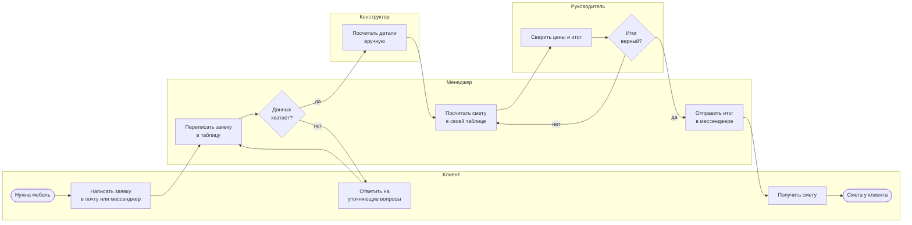
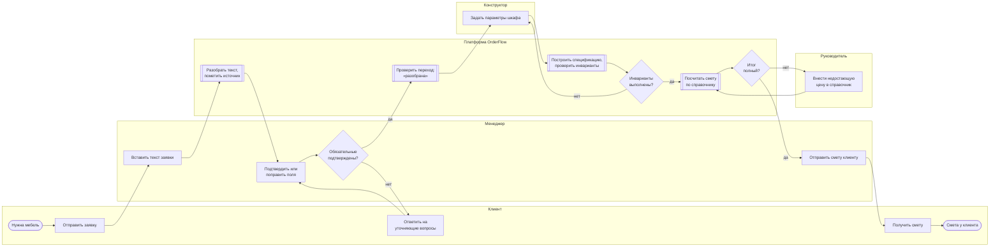

# Процессы: как сейчас и как будет

BPMN 2.0: [as-is.bpmn](as-is.bpmn), [to-be.bpmn](to-be.bpmn) (bpmn.io, Camunda Modeler).
Ниже они же в Mermaid.

## As-is: почта → таблица → ручной расчёт

## To-be: через OrderFlow

## Что изменилось

- Текст разбирает платформа, человек только подтверждает или правит поле (FR-02, FR-04).
- У каждого значения видно, откуда оно: фрагмент текста или ручной ввод (FR-03).
- Детали строятся из параметров шкафа и проверяются инвариантами (FR-06, FR-07).
- Один справочник цен вместо личных таблиц; неполный итог виден сразу (FR-08…FR-11).
- Петля «руководитель пересчитывает за менеджером» ушла, статус ведёт сервер (FR-12).
