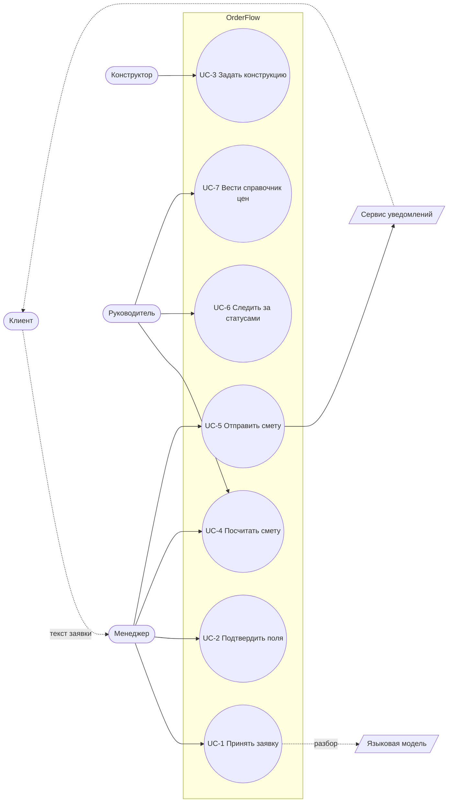

# Варианты использования

## Акторы

| Актор | Тип | Цель |
|---|---|---|
| Клиент | внешний, человек | получить смету на изделие по своим размерам |
| Менеджер | внутренний | быстро превратить текст заявки в проверенные данные и отправить смету |
| Конструктор | внутренний | получить спецификацию деталей без ручного счёта |
| Руководитель | внутренний | видеть статусы и держать цены в одном справочнике |
| Сервис уведомлений | внешняя система | доставить смету клиенту (в демо — заглушка) |
| Языковая модель | внешняя система | разобрать текст заявки (в демо — правила, адаптер-заглушка) |

## Диаграмма

UC-7 в демо не реализован: справочник заполняется начальными данными (seed).

## Сценарии

### UC-1. Принять заявку

| | |
|---|---|
| Актор | Менеджер |
| Предусловие | есть текст заявки от клиента или данные с его слов |
| Результат | заявка в статусе «новая», найденные поля помечены «найдено в тексте» |
| Требования | FR-01, FR-02, FR-03 |

Основной сценарий:
1. Менеджер открывает «Новая заявка» и вставляет текст.
2. Нажимает «Разобрать текст».
3. Система создаёт заявку, разбирает текст правилами, у каждого найденного поля
   ставит источник «найдено в тексте», флаг «не подтверждено» и фрагмент исходного текста.
4. Система показывает список того, что мешает считать заявку разобранной.

Альтернативный сценарий:
- 1а. Текста нет (звонок): менеджер нажимает «Заполнить вручную», система создаёт
  пустую заявку, поля вводятся руками с источником «ввёл человек».

Исключения:
- 3а. В тексте ничего не найдено: заявка создаётся без полей, все обязательные
  попадают в список недостающих.
- 3б. Включён адаптер языковой модели, но он не настроен: работает разбор правилами,
  заявка помечается разборщиком `llm`, поведение для пользователя не меняется.

### UC-2. Подтвердить поля

| | |
|---|---|
| Актор | Менеджер |
| Предусловие | заявка в статусе «новая» |
| Результат | все обязательные поля заполнены и подтверждены, статус «разобрана» |
| Требования | FR-03, FR-04, FR-12 |

Основной сценарий:
1. Менеджер сверяет поле с фрагментом текста и нажимает «Подтвердить».
2. Система помечает поле подтверждённым, источник остаётся «найдено в тексте».
3. Когда список недостающего пуст, менеджер нажимает «Заявка разобрана».
4. Сервер проверяет условия перехода и ставит статус «разобрана».

Альтернативный сценарий:
- 1а. Значение неверно: менеджер правит его и нажимает «Сохранить». Источник
  становится «ввёл человек», фрагмент текста убирается.
- 1б. Поля нет в тексте: менеджер уточняет у клиента и вводит его сам.

Исключения:
- 4а. Остались неподтверждённые предположения или пустые обязательные поля: сервер
  отвечает 409 и списком причин, статус не меняется.
- 1в. В числовое поле введён текст: сервер отвечает 422, поле не меняется.

### UC-3. Задать конструкцию

| | |
|---|---|
| Актор | Конструктор |
| Предусловие | заявка «разобрана» (или уже есть конструкция / смета) |
| Результат | спецификация деталей и фурнитуры, статус «конструкция готова» |
| Требования | FR-05, FR-06, FR-07, FR-13 |

Основной сценарий:
1. Система подставляет габариты, число полок и дверей из подтверждённых полей.
2. Конструктор уточняет толщину плиты, материалы, наличие задней стенки.
3. Нажимает «Построить спецификацию».
4. Система проверяет инварианты, строит детали и фурнитуру, ставит статус.

Альтернативный сценарий:
- 4а. Смета уже была: она удаляется как устаревшая, статус возвращается
  на «конструкция готова».

Исключения:
- 4б. Инвариант нарушен (полки не помещаются по высоте, дверь уже 250 мм или шире
  700 мм, размер вне пределов, плита другой толщины): 422 и список причин,
  спецификация не сохраняется.

### UC-4. Посчитать смету

| | |
|---|---|
| Актор | Менеджер или руководитель |
| Предусловие | статус «конструкция готова» или «смета готова» |
| Результат | смета с разбивкой, статус «смета готова» |
| Требования | FR-08, FR-09, FR-10, FR-11 |

Основной сценарий:
1. Пользователь нажимает «Посчитать смету».
2. Система считает площадь плиты по материалам, кромку, фурнитуру, применяет
   коэффициенты запаса и цены справочника.
3. Показывает строки (нетто, запас, в смету, цена, дата цены, сумма), итоги по видам
   и общий итог.

Исключения:
- 2а. У материала нет цены: строка без суммы, итог помечен «неполный».
- 2б. Цены разных дат: предупреждение с перечнем дат.
- 2в. Материала нет в справочнике: 422.

### UC-5. Отправить смету

| | |
|---|---|
| Актор | Менеджер |
| Предусловие | статус «смета готова», итог полный |
| Результат | статус «отправлена клиенту», запись в истории |
| Требования | FR-10, FR-12, FR-16 |

Основной сценарий: менеджер нажимает «Отправить клиенту», сервер проверяет полноту
сметы, передаёт её адаптеру уведомлений (в демо — запись в журнал) и меняет статус.

Исключения: итог неполный или сметы нет — 409, кнопка в интерфейсе неактивна.

### UC-6. Следить за статусами

Руководитель видит список заявок со статусами и у каждой заявки — шаги и историю
переходов. Перепрыгнуть шаг нельзя: сервер отвечает 409 (FR-12, FR-18).
