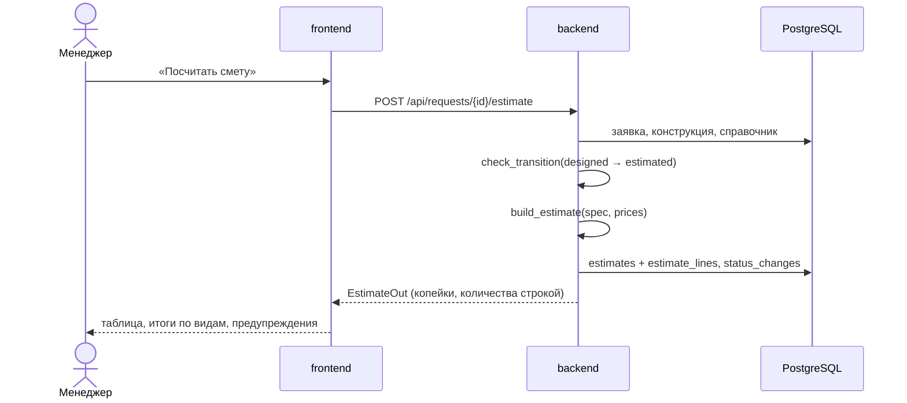

# Архитектура

Модель C4, два уровня. Контракт API — [openapi.yaml](openapi.yaml), данные — [er.md](er.md),
решения — [adr/](adr/).

## Контекст


Пунктир — точки расширения: интерфейс есть, в демо работает заглушка без сети.

## Контейнеры


## Слои бэкенда

```
app/
├── api/routes.py        HTTP: схемы запроса и ответа, коды ошибок
├── services.py          сценарии: создать заявку, подтвердить поле, сменить статус,
│                        сохранить конструкцию, посчитать смету
├── domain/              чистая логика без БД и HTTP — покрыта unit-тестами
│   ├── parser.py        RequestParser, RuleBasedParser, LlmRequestParser (заглушка)
│   ├── fields.py        поля заявки, источник, правило подтверждения
│   ├── design.py        модель шкафа → спецификация, инварианты
│   ├── estimate.py      спецификация + цены → смета
│   ├── money.py         копейки и Decimal
│   └── status.py        машина состояний заявки
├── integrations/        адаптеры внешних систем: уведомления, учётная система
├── models.py            таблицы SQLAlchemy
└── main.py              сборка приложения, обработчики ошибок
```

Правило зависимостей: `domain` не импортирует ничего из `api`, `services`, `models`.
Поэтому расчёт сметы и разбор текста тестируются без базы за доли секунды,
а интеграционные тесты проверяют только склейку с PostgreSQL и HTTP.

## Поток «смета готова»



## Что сознательно не сделано

- Нет очереди и фоновых задач: расчёт сметы занимает миллисекунды.
- Нет авторизации и ролей в API: в демо один интерфейс. Перед боевым запуском —
  вход и права по ролям из 01-problem.md.
- Нет кэша справочника: справочник маленький, читается при каждом расчёте.
