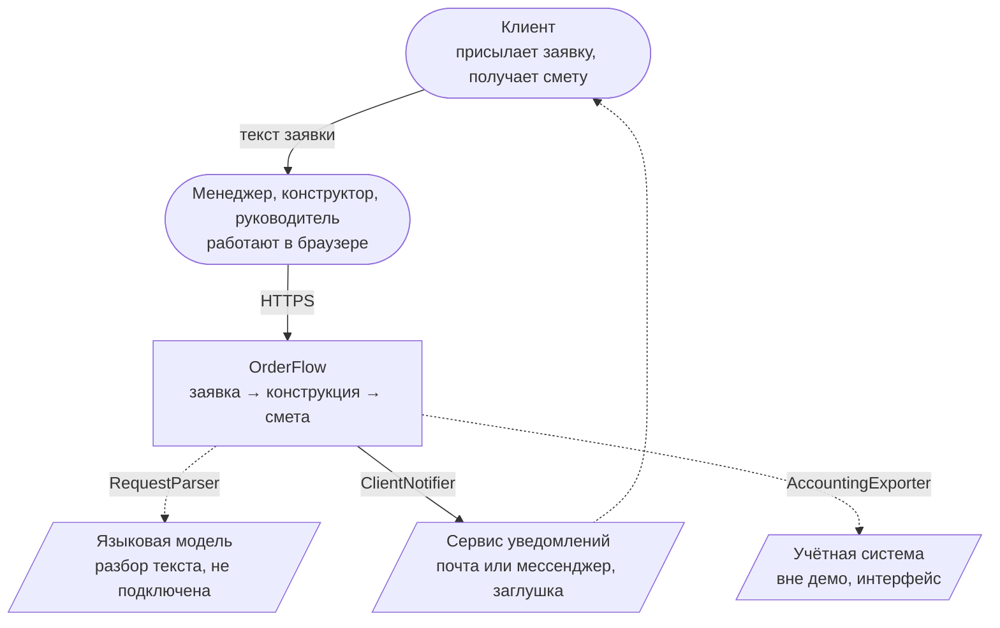
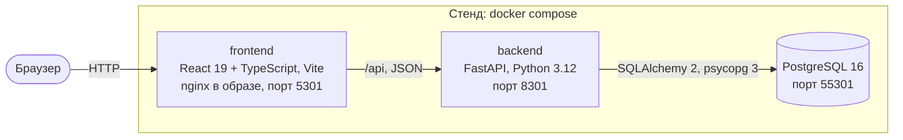

# Архитектура

C4, два уровня. Контракт — [openapi.yaml](openapi.yaml), данные — [er.md](er.md),
решения — [adr/](adr/).

## Контекст

Пунктир — точки расширения: интерфейс есть, в демо работает заглушка без сети.

## Контейнеры

Предметная логика (разбор, конструкция, смета, статусы) не зависит от базы и HTTP,
поэтому покрыта быстрыми unit-тестами. Авторизации и ролей в API нет.
