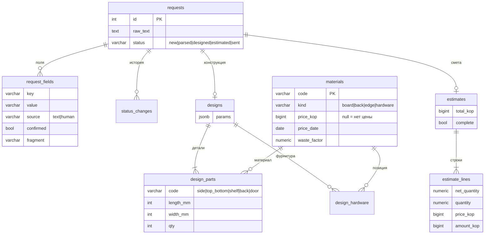

# Модель данных

Схема — миграция в `backend/alembic/versions/`, на диаграмме главные поля.

## Словарь

| Сущность | Смысл |
|---|---|
| requests | заявка; `status` ограничен `CHECK`, меняет его только сервер |
| request_fields | `source` — откуда значение, `confirmed` — подтвердил ли человек, `fragment` — кусок текста |
| status_changes | журнал переходов, по нему строится история |
| designs, design_parts | параметры шкафа и детали в целых мм |
| materials | справочник: цена в копейках (`null` — цены нет), дата цены, коэффициент запаса |
| estimates, estimate_lines | смета-снимок: количества и цены копируются в строки. `total_kop` при `complete = false` — нижняя граница |
