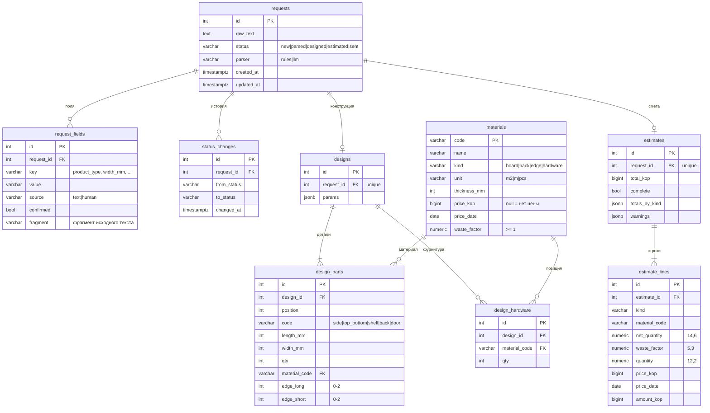

# Модель данных

Схема создаётся миграцией `backend/alembic/versions/0001_initial_schema.py`.

## Словарь данных

| Таблица | Поле | Смысл |
|---|---|---|
| requests | status | статус заявки, ограничен `CHECK`; переход меняет только сервер |
| requests | parser | каким разборщиком разобран текст: `rules` или `llm` |
| request_fields | source | `text` — найдено в тексте, `human` — ввёл человек |
| request_fields | confirmed | человек подтвердил значение; без этого поле не считается заполненным |
| request_fields | fragment | кусок исходного текста, из которого взято значение; у ручного ввода пусто |
| status_changes | — | журнал переходов, по нему строится история заявки |
| designs | params | параметры шкафа целиком (габариты, толщина, полки, двери, материалы) |
| design_parts | edge_long / edge_short | сколько длинных и коротких сторон детали оклеено кромкой |
| materials | price_kop | цена за единицу в копейках; `null` — цены нет, итог сметы будет неполным |
| materials | price_date | дата цены; разные даты в одной смете дают предупреждение |
| materials | waste_factor | коэффициент запаса на обрезки и брак |
| estimate_lines | net_quantity | количество без запаса, точно (м², м, шт.) |
| estimate_lines | quantity | количество в смету: нетто × запас, округлено один раз |
| estimate_lines | amount_kop | сумма строки в копейках; `null`, если нет цены |
| estimates | total_kop | сумма известных строк; при `complete = false` это нижняя граница |

Смета хранится снимком: цены и количества копируются в `estimate_lines`. Если справочник
потом изменится, отправленная клиенту смета останется прежней.
