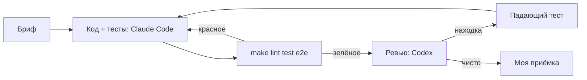

# 04. Разработка с AI-агентами

Код и тесты писал Claude Code по моим брифам, ревью делал Codex. Постановка, допущения
и приёмка — мои; находки ревью я сначала подтверждал падающим тестом и проверял откатом фикса. Шаблоны брифов — в [`ai-workflow/`](https://github.com/Georgy213123/ai-product-engineering/tree/main/ai-workflow).

## Конвейер задачи

«Замечаний нет» без перечня проверенного не принимаю, «тесты проходят» проверяю своим
прогоном, регрессионный тест пишу до исправления.

## Декомпозиция

| Задача | Кто | Готово, когда |
|---|---|---|
| Постановка, BPMN, FR/NFR, истории | я, черновик — Claude Code | у истории Given/When/Then и FR |
| Контракт, разбор текста | Claude Code | тест сверки `openapi.yaml`, тесты единиц |
| Конструкция, смета, статусы | Claude Code | итог сходится с ручным, 409 на пропуск шага |
| Интерфейс и e2e | Claude Code | Vitest и Playwright на десктопе и телефоне |
| Ревью и исправления | Codex, потом я + Claude Code | падающий тест до исправления |

## Ревью Codex, круг 1

Codex (gpt-6.1-sol, effort high, только чтение) получил репозиторий без моих выводов.
Пришло 10 находок, 4 P1 и 6 P2. Подтверждённой считал находку, которую воспроизвёл тестом
или запуском.

| № | Находка | Вердикт | Тест |
|---|---|---|---|
| R-01 P1 | фикстура делает `downgrade base` и `TRUNCATE` на любой базе из `DATABASE_URL` | подтверждено: заявка стёрта; теперь только база `_test` | `unit/test_review_fixes.py::test_r01_*` |
| R-02 P1 | при переключении заявок форма берёт конструкцию предыдущей | подтверждено в Vitest; данные применяются, только если `request_id` совпал | `App.test.tsx` R-02 |
| R-03 P1 | смета читает конструкцию без блокировки и остаётся от заменённой | подтверждено на PostgreSQL: 1 233 196 коп. вместо 1 165 888; `SELECT … FOR UPDATE` | `test_r03_*` |
| R-04 P1 | запоздавший ответ по прежней заявке открывает её | подтверждено в Vitest; ответ сверяется с открытой заявкой | `App.test.tsx` R-04 |
| R-05 P2 | две параллельные отправки — два уведомления, уведомление до `commit` | подтверждено: два ответа 200; блокировка, уведомление после фиксации | `test_r05_concurrent_send_notifies_once` |
| R-06 P2 | значение длиннее 255 символов — 500 от PostgreSQL | подтверждено; `max_length=255`, длинное найденное отбрасывается | `test_r06_*` |
| R-07 P2 | число из тысяч цифр ломает `int()`, 500 | подтверждено; длина чисел в выражениях ограничена | `test_r07_*` |
| R-08 P2 | необязательное поле нельзя очистить | подтверждено; кнопка «Убрать», сервер удаляет пустое поле | `FieldRow.test.tsx`, `test_r08_*` |
| R-09 P2 | часть 422 в контракте описана как `HTTPValidationError` | подтверждено: расходился только контракт; `Problem` на весь роутер | `test_r09_*` |
| R-10 P2 | сквозной тест отправки не проверяет уведомление | подтверждено: без вызова `send_estimate` тест проходил | `test_r10_send_actually_notifies_client` |

Опровергнутых и отложенных нет.

## Внешний аудит между кругами

После первого круга был внешний аудит — отдельная проверка, не Codex. Пять замечаний, все приняты в v0.3.3.

| № | Замечание | Вердикт | Тест или проверка |
|---|---|---|---|
| A-01 | у числа полок и дверей нет верхней границы: `shelves: 1000000000` доходил до расчёта | подтверждено, BUG-12; 422 выше 10 и 4 | `test_bug12_design_input_has_upper_limits` |
| A-02 | интеграционные тесты падали на базе с чужой `alembic_version` | подтверждено; схема пересоздаётся перед миграциями, только на `*_test` | `tests/db_guard.py`, `integration/conftest.py` |
| A-03 | подпись «Задняя стенка» в итогах стояла среди названий материалов | подтверждено; «ХДФ (задняя стенка)» | e2e `order-flow.spec.ts`: «ХДФ (задняя стенка)» в смете |
| A-04 | фронт собирался на другой версии Node, чем CI и README | подтверждено; Node 24 | CI |
| A-05 | `GET /api/health` в контракте с ответом 422 | подтверждено; ответ убран | `test_bug12_health_contract_has_no_422` |

## Ревью Codex, круг 2

Тот же Codex по исправленному проекту, только дифф. Три находки, все подтвердились, отложенных нет.

| № | Находка | Вердикт | Тест |
|---|---|---|---|
| OF-01 P1 | статус «отправлена» фиксировался до отправки сметы: сбой уведомления оставлял `sent` без письма | подтверждено, BUG-13; сначала отправка с ключом идемпотентности, потом статус | `test_bug13_*` |
| OF-02 P2 | поздний ответ раннего сохранения полей стирал свежие правки | подтверждено в Vitest; сохранения идут по очереди | `App.test.tsx` OF-02 |
| OF-03 P2 | пример из README «120 на 210» разбирался не полностью | подтверждено; парсер понимает «N на M» | `test_of03_readme_example_is_fully_parsed` |

Правило для тестов: интеграционные тесты идут на отдельной базе `orderflow_test` (защита в `db_guard.py`), каждый начинает с `TRUNCATE`, от порядка запуска не зависят.

## Что я из этого вынес

- Тесты агента проверяли один запрос за раз и пропустили гонки (R-03, R-05) и устаревшие
  ответы в интерфейсе (R-02, R-04). Теперь есть тесты, которые управляют порядком событий.
- Первый тест на R-02 гонку не воспроизвёл: React склеил обновления внутри `act`. Помогла
  задержка ответа на конкретный запрос.
- Codex воспроизводил гонки на SQLite в памяти и сам об этом написал. Каждую находку я
  перепроверил на PostgreSQL.
