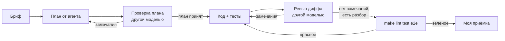

# 04. Разработка с AI-агентами

Кейс я собирал с Claude Code и Codex. Код и тесты писал Claude Code, независимое ревью
готового кейса делал Codex. Я отвечаю за постановку, приёмку и за то, что попало
в репозиторий. Общие правила и шаблоны брифов —
в каталоге `ai-workflow/` в корне витрины.

## Как резал задачу

Сначала аналитика, потом контракт, потом код слоями снизу вверх. Каждая задача
маленькая, с проверяемым критерием готовности, и её можно отдать агенту без
пересказа всего проекта.

| № | Задача | Исполнитель | Вход | Критерий готовности |
|---|---|---|---|---|
| 1 | Постановка, роли, границы демо | я | описание боли, интервью-допущения | 01-problem.md, список «вне рамок» |
| 2 | BPMN as-is и to-be, use case, FR/NFR, истории | я + Claude Code (черновик) | 01-problem.md | у каждой истории Given/When/Then и ссылка на FR |
| 3 | Модель данных и контракт API | Claude Code | истории, FR | er.md, pydantic-схемы, `make openapi` |
| 4 | Разбор текста заявки | Claude Code | FR-02, набор примеров текстов заявок | unit-тесты на единицы, слова-числа, телефон |
| 5 | Модель шкафа и спецификация | Claude Code | FR-05…FR-07, допущения из requirements.md | инварианты покрыты тестами, детали считаются целыми мм |
| 6 | Смета | Claude Code | FR-08…FR-11, ADR-0003 | итог образцового шкафа сходится с ручным расчётом |
| 7 | Статусы и сервисный слой | Claude Code | ADR-0004 | 409 на любой пропуск шага, история переходов |
| 8 | Интеграционные тесты на PostgreSQL | Claude Code | сервисный слой, миграция | сквозной сценарий через HTTP и реальную БД |
| 9 | Интерфейс | Claude Code | openapi.yaml, истории US-01…US-07 | Vitest зелёный, поля подписаны |
| 10 | e2e Playwright, десктоп и телефон | Claude Code | истории, ожидаемый итог | сценарий из US-01…US-05 и US-07 зелёный |
| 11 | Независимое ревью всего кейса | Codex gpt-6.1-sol, только чтение | репозиторий кейса | находки с серьёзностью и способом воспроизведения |
| 12 | Разбор находок, исправления, документация | я + Claude Code | отчёт ревью | у каждой подтверждённой находки падающий тест до исправления |

## Конвейер одной задачи

Правила, которых держусь:

- **Проверяет другая модель.** Код писал Claude Code, ревьюил Codex.
  Одна модель склонна соглашаться со своим решением.
- **Пустой ответ ревьюера — не одобрение.** «Замечаний нет» без разбора того, что
  проверено, я считаю непроведённым ревью и прошу перечислить, какие инварианты
  и граничные случаи ревьюер прошёл.
- **Отчёт агента — не доказательство.** «Тесты проходят» проверяю сам прогоном.
- **Регрессионный тест пишется до исправления.** Сначала тест, который падает
  на баге, потом исправление.

## Разбор задачи: смета (задача 6)

### Бриф

> **Цель.** Функция `build_estimate(spec, prices) -> Estimate`: смета из спецификации
> и справочника материалов.
>
> **Контекст.** `app/domain/design.py` — детали и фурнитура в целых мм и штуках.
> Справочник: цена за единицу, дата цены, коэффициент запаса, единица (м², м, шт.).
> Требования FR-08…FR-11, NFR-01, ADR-0003. Модуль без БД и HTTP.
>
> **Критерий готовности.**
> 1. Площадь плиты по каждому материалу, кромка в погонных метрах, фурнитура в штуках.
> 2. Строка: нетто, коэффициент, количество в смету, цена, дата, сумма.
> 3. Нет цены — сумма `None`, итог `complete = False`, предупреждение.
> 4. Цены разных дат — предупреждение.
> 5. Итог шкафа 1200 × 2100 × 600, 4 полки, 2 двери, плита 16 мм равен ручному
>    расчёту (таблица в 05-testing.md).
> 6. mypy strict, ruff, unit-тесты; регрессионные тесты на BUG-01 и BUG-05.
>
> **Образец.** Стиль как в `app/domain/design.py`: dataclass-ы, чистые функции,
> ошибки — исключениями предметной области.

## Ревью Codex gpt-6.1-sol

Готовый кейс я отдал Codex (gpt-6.1-sol, effort high, режим только чтения) без своих
выводов: только репозиторий и просьбу найти проблемы с серьёзностью и способом
воспроизведения. Пришло 10 находок: 4 высокой серьёзности (P1), 6 средней (P2).

Правило разбора: находка подтверждена, только если я её воспроизвёл тестом или
запуском. Рассуждение «похоже на правду» не считается. Для каждой подтверждённой
сначала писал тест, видел его падение, потом исправлял.

| № | Находка | Серьёзность | Вердикт | Что сделал | Тест |
|---|---|---|---|---|---|
| R-01 | интеграционная фикстура делает `downgrade base` и `TRUNCATE` на любой базе из `DATABASE_URL` | P1 | подтверждено: на отдельной базе с одной заявкой после прогона осталось 0 строк | фикстура требует имя базы с суффиксом `_test`, иначе отказ; повторный запуск — заявка цела | `tests/unit/test_review_fixes.py::test_r01_*` |
| R-02 | при переключении заявок форма конструкции инициализируется конструкцией предыдущей заявки | P1 | подтверждено в Vitest: под заявкой №2 видна спецификация №1 | данные прежней заявки сбрасываются сразу, заявка, конструкция и смета применяются вместе; панель показывает конструкцию, только если `request_id` совпадает | `frontend/src/App.test.tsx` R-02 |
| R-03 | расчёт сметы читает конструкцию без блокировки, параллельная замена конструкции оставляет смету от старой | P1 | подтверждено на PostgreSQL: смета 1 233 196 коп. при конструкции с тремя полками (верно 1 165 888) | все операции, меняющие заявку, берут строку заявки `SELECT … FOR UPDATE` | `tests/integration/test_review_fixes.py::test_r03_*` |
| R-04 | запоздавший ответ по прежней заявке подменяет открытую | P1 | подтверждено в Vitest: выделена №2, открыта №1 | ответ применяется, только если заявка всё ещё открыта (`useRef` с текущим id), в том числе после сохранений | `App.test.tsx` R-04 |
| R-05 | два параллельных запроса «отправить» дают два уведомления и две записи `sent`; уведомление до `commit` | P2 | подтверждено на PostgreSQL: два ответа 200 | блокировка строки + уведомление после фиксации статуса; второй запрос получает 409 | `test_r05_concurrent_send_notifies_once` |
| R-06 | значение поля длиннее 255 символов даёт 500 от PostgreSQL | P2 | подтверждено: ручное поле 256 символов проходило pydantic и падало в базе | `max_length=255` на значениях `fields`; найденное в тексте длиннее колонки отбрасывается | `test_r06_*` (unit и integration) |
| R-07 | число из тысяч цифр в тексте ломает `int()`, 500 при создании заявки | P2 | подтверждено: `ValueError` на «полок: 9…9» | длина чисел в выражениях ограничена: размер — 5 цифр, количество — 2 | `test_r07_*` |
| R-08 | необязательное поле нельзя очистить в интерфейсе | P2 | подтверждено в Vitest; на сервере пустое значение оставляло пустую запись | кнопка «Убрать» для необязательного поля; сервер удаляет поле при пустом значении | `FieldRow.test.tsx` R-08, `test_r08_*` |
| R-09 | часть ответов 422 в контракте описана как `HTTPValidationError`, а сервер отвечает `{message, problems}` | P2 | подтверждено: формат ответа уже был `Problem`, расходился только контракт | 422 с моделью `Problem` объявлен на весь роутер, контракт перевыгружен | `test_r09_contract_declares_problem_for_every_422` |
| R-10 | сквозной тест отправки не проверяет, что уведомление ушло | P2 | подтверждено: убрал вызов `notifier.send_estimate` — прежний тест прошёл | новый тест проверяет получателя и сумму; при той же подмене он падает | `test_r10_send_actually_notifies_client` |

Опровергнутых и отложенных находок нет: все десять воспроизвелись.

Что я вынес из ревью:

- Мои тесты проверяли один запрос за раз. Гонки (R-03, R-05) и устаревшие ответы
  в интерфейсе (R-02, R-04) так не ловятся: нужен тест, который управляет порядком
  событий. Теперь такие тесты есть и на PostgreSQL, и в Vitest.
- В jsdom гонку R-02 первая версия моего теста не воспроизвела: React склеил
  обновления внутри `act`. Помогла задержка ответа на конкретный запрос.
- Ревьюер честно указал границы своей проверки: гонки он воспроизводил на SQLite в
  памяти, PostgreSQL и e2e не запускал. Поэтому каждую находку я перепроверил сам
  на PostgreSQL.

## Что агенту не отдаю

- Решение, что входит в демо, а что нет.
- Допущения предметной области (зазоры, коэффициенты запаса): их фиксирую сам
  в requirements.md, агент получает их как вход.
- Приёмку: последний прогон `make lint test e2e` и чтение диффа — мои.
