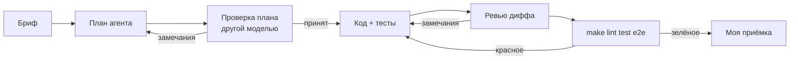

# 04. Разработка с AI-агентами

Код и тесты писал Claude Code по моим брифам, ревью делал Codex. Постановка, допущения
и приёмка — мои. Шаблоны брифов — в [`ai-workflow/`](../../../ai-workflow/).

## Конвейер задачи

«Замечаний нет» без перечня проверенного не принимаю, «тесты проходят» проверяю своим
прогоном, регрессионный тест пишу до исправления.

## Декомпозиция

| Задача | Кто | Готово, когда |
|---|---|---|
| Постановка, BPMN, FR/NFR, истории | я, черновик — Claude Code | у истории Given/When/Then и FR |
| Контракт, разбор текста | Claude Code | тест сверки `openapi.yaml`, тесты единиц |
| Конструкция, смета, статусы | Claude Code | итог сходится с ручным, 409 на пропуск шага |
| Интерфейс и e2e | Claude Code | Vitest и Playwright на десктопе и телефоне |
| Ревью и исправления | Codex, потом я + Claude Code | падающий тест до исправления |

## Ревью Codex

Codex (gpt-6.1-sol, effort high, только чтение) получил репозиторий без моих выводов.
Пришло 10 находок, 4 P1 и 6 P2. Подтверждённой считал находку, которую воспроизвёл тестом
или запуском.

| № | Находка | Вердикт | Тест |
|---|---|---|---|
| R-01 P1 | фикстура делает `downgrade base` и `TRUNCATE` на любой базе из `DATABASE_URL` | подтверждено: заявка стёрта; теперь только база `_test` | `unit/test_review_fixes.py::test_r01_*` |
| R-02 P1 | при переключении заявок форма берёт конструкцию предыдущей | подтверждено в Vitest; данные применяются, только если `request_id` совпал | `App.test.tsx` R-02 |
| R-03 P1 | смета читает конструкцию без блокировки и остаётся от заменённой | подтверждено на PostgreSQL: 1 233 196 коп. вместо 1 165 888; `SELECT … FOR UPDATE` | `test_r03_*` |
| R-04 P1 | запоздавший ответ по прежней заявке открывает её | подтверждено в Vitest; ответ сверяется с открытой заявкой | `App.test.tsx` R-04 |
| R-05 P2 | две параллельные отправки — два уведомления, уведомление до `commit` | подтверждено: два ответа 200; блокировка, уведомление после фиксации | `test_r05_concurrent_send_notifies_once` |
| R-06 P2 | значение длиннее 255 символов — 500 от PostgreSQL | подтверждено; `max_length=255`, длинное найденное отбрасывается | `test_r06_*` |
| R-07 P2 | число из тысяч цифр ломает `int()`, 500 | подтверждено; длина чисел в выражениях ограничена | `test_r07_*` |
| R-08 P2 | необязательное поле нельзя очистить | подтверждено; кнопка «Убрать», сервер удаляет пустое поле | `FieldRow.test.tsx`, `test_r08_*` |
| R-09 P2 | часть 422 в контракте описана как `HTTPValidationError` | подтверждено: расходился только контракт; `Problem` на весь роутер | `test_r09_*` |
| R-10 P2 | сквозной тест отправки не проверяет уведомление | подтверждено: без вызова `send_estimate` тест проходил | `test_r10_send_actually_notifies_client` |

Опровергнутых и отложенных нет.

## Что я из этого вынес

- Мои тесты проверяли один запрос за раз и пропустили гонки (R-03, R-05) и устаревшие
  ответы в интерфейсе (R-02, R-04). Теперь есть тесты, которые управляют порядком событий.
- Первый тест на R-02 гонку не воспроизвёл: React склеил обновления внутри `act`. Помогла
  задержка ответа на конкретный запрос.
- Codex воспроизводил гонки на SQLite в памяти и сам об этом написал. Каждую находку я
  перепроверил на PostgreSQL.
